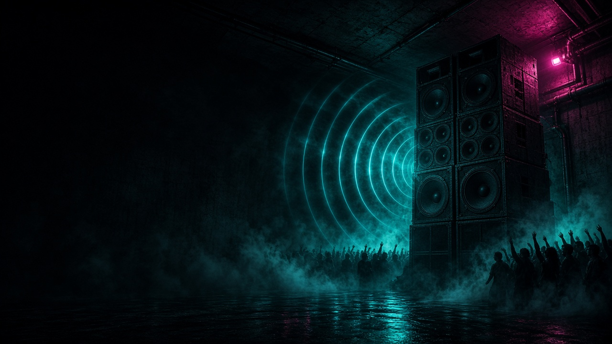

# Basement Protocol

50 hand-composed, monophonic MIDI bassline loops for techno, acid, drum and bass, bassline house, and electro, plus a browser lab that plays the real files and the open generator that builds them.

- **Live lab:** https://mizcausevic-dev.github.io/basement-protocol/
- **Media kit:** https://mizcausevic-dev.github.io/basement-protocol/media.html
- **Article:** https://mizcausevic-dev.github.io/basement-protocol/article.html
- **Download:** [`pack/basement-protocol-50-bass-midi-Cursor.zip`](pack/basement-protocol-50-bass-midi-Cursor.zip)



## What is in the pack

| Item | Path |
| --- | --- |
| 50 Standard MIDI Files (format 0, 480 PPQ, channel 1) | `pack/midi/BPxx_<name>-Cursor.mid` |
| Pattern index, one row per pattern | `pack/pattern-index-Cursor.csv` |
| Note events, one row per note | `pack/note-events-Cursor.csv` |
| Manifest with SHA-256 per file, used by the site | `pack/manifest-Cursor.json` |
| Validation report | `pack/validation-report-Cursor.json` |
| Everything above except the manifest and report, zipped | `pack/basement-protocol-50-bass-midi-Cursor.zip` |

Seven groove families: sparse (7), rolling (8), offbeat (7), syncopated (8), staccato (7), sustained (6), acid (7). Loop lengths: 12 one-bar, 25 two-bar, 13 four-bar. Tempos from 105 to 174 BPM.

## Conventions

- **Note names:** scientific pitch notation, MIDI 60 = C4. Ableton Live labels MIDI 60 as C3 and FL Studio as C5. MIDI note numbers are authoritative.
- **Positions:** zero-based quarter-note beats. The CSVs also carry raw ticks.
- **Loop boundary:** end-of-track sits exactly on 1920, 3840, or 7680 ticks. No note crosses it.
- **Monophony:** only BP40, BP44, BP46, BP47, and BP49 are legato. Their slides overlap the next note by exactly 30 ticks. Glide depends on the receiving synth.
- **Chromatic notes:** nine notes across seven patterns sit outside the stated scale. Each is labeled with its reason in both CSVs.
- **Velocity:** accents 122 to 127, normal 92 to 110, ghosts 76 and shorter. Grooves still read on a velocity-insensitive patch.
- **Sound design:** suggestions live in the index CSV only. No synth settings are in the MIDI.

## Run it locally

Requirements: Python 3.10 or newer, Node 20 or newer.

```bash
python3 generator/basement_protocol.py      # writes pack/ (standard library only)
pip install -r generator/requirements.txt   # mido 1.3.3, for validation
npm ci
npm run validate                            # mido checks + @tonejs/midi cross-parse
npm run dev                                 # http://127.0.0.1:47321
```

`npm run dev` and `npm run build` copy `pack/` and `article/` into `public/` first, so the site always serves the same files as the download.

| Script | What it does |
| --- | --- |
| `npm run pack` | Regenerates every MIDI file, both CSVs, the manifest, and the ZIP |
| `npm run validate` | Runs `generator/validate.py` (12 checks) and `scripts/validate-tonejs.mjs` (second parser) |
| `npm run dev` | Vite dev server on port 47321 |
| `npm run build` | Typecheck and static build into `dist/` |
| `npm run preview` | Serves `dist/` on port 47322 |
| `npm run deploy` | Rebuilds, validates, guards `dist/`, and publishes to `gh-pages` |
| `npm run media` | Renders the soundtrack from pack MIDI, then the commercial, social images, and manifest |
| `npm run media:social` | Rebuilds social images, the carousel PDF, and the copy sheet |

## Validation

`generator/validate.py` re-parses every file with mido and does not import the generator. It checks file count and ID consistency, parsing, tempo and 4/4 meta, end-of-track placement and note pairing, pitch and velocity ranges, monophony and legato labeling, an exact match against both CSVs, scale membership and chromatic labels, distinctness (four fingerprints plus a set-similarity check), family and loop-length coverage, a ghost-note proxy, and ZIP integrity. `scripts/validate-tonejs.mjs` then parses all 50 files with @tonejs/midi and compares every note to the CSV.

Current result: 12 of 12 checks pass, and the second parser matches all 700 notes. The generator is deterministic: rerunning it produces byte-identical MIDI and CSV files.

Limitations, also recorded in the report:

- Groove feel and musical quality are judgments. Only the ghost-note proxy is automated.
- Glide on legato overlaps depends on the receiving instrument.
- The files were not imported into commercial DAWs in the build environment.
- Near-duplicate detection compares onset and pitch-class sets, not perceived similarity.

## Writing a pattern

Patterns are defined in `generator/basement_protocol.py` as step strings plus semitone intervals above a root MIDI note:

```python
P("BP44", "Acid Rain", "acid", 130, 33, "phrygian",
  ["XxsxX.xsxX.xsXxx"],
  [0, 0, 12, 10, 0, 12, 1, 0, 13, 0, 7, 12, 0, 3],
  gate=0.5, vel=(127, 96, 76))
```

`X` accent, `x` normal, `o` ghost, `S`/`s` slide into the next note, `-` hold, `.` rest. Grids: 4 (16ths), 3 (8th triplets), 6 (16th triplets), 8 (32nds). An out-of-scale note that is not declared in `chromatic={...}` stops the build.

## Site architecture

- `src/pack-context.tsx` loads the manifest and report, then fetches and parses all 50 `.mid` files with @tonejs/midi.
- `src/audio/engine.ts` is a Web Audio mono bass synth (two oscillators, waveshaper, resonant low-pass, sine sub) with synthesized reference drums and a 25 ms lookahead scheduler.
- `src/components/` holds the lab, piano roll, groove map, mindmap, pipeline decoder, validation panel, and brief.
- `src/lib/theme.tsx` plus `src/index.css` provide seven themes (Cosmic Cyber, Bento Grid, Swiss Architect, Aqua Web 2.0, Pop Brutalist, Steel Tactical, Parchment) in light and dark, saved in localStorage.
- Stack: Vite 8, React 19, TypeScript, Tailwind CSS 4, shadcn/ui on Base UI, Motion.

No cookies, analytics, or forms. Fonts are self-hosted through Fontsource.

## Media kit

The 30-second spot and the social images live under `media/`. The soundtrack is rendered from BP01, BP11, BP44, and BP50 in `pack/midi` by `media/soundtrack.py`, then loudness-normalized to -14 LUFS integrated and -1.5 dBTP. Headless Chrome steps the HTML composition frame by frame into ffmpeg.

```bash
pip install -r media/requirements.txt   # numpy, mido 1.3.3
npm run media                           # soundtrack + videos + social + manifest
```

Outputs land in `media/out/` and are copied to `public/media/` on `npm run dev` and `npm run build`.

| File | What it is |
| --- | --- |
| `media/out/basement-protocol-commercial-{16x9,9x16,1x1}-Cursor.mp4` | 30 s cuts, H.264 + AAC, CRF 23 capped at 8 Mbps |
| `media/out/basement-protocol-commercial-*-poster-Cursor.jpg` | Poster frames |
| `media/out/basement-protocol-commercial-Cursor.vtt` | Captions, including sound cues |
| `media/out/social/*-Cursor.jpg` | Images for Instagram, TikTok, YouTube, X, Facebook, LinkedIn, Pinterest, Reddit, Threads, Bluesky |
| `media/out/social/basement-protocol-carousel-Cursor.pdf` | 5-slide carousel |
| `media/out/social/POSTS-Cursor.md` | Per-network copy, alt text, and measured lengths |
| `media/out/media-manifest-Cursor.json` | Sizes, durations, loudness, and file list for the site |

Those ten networks are the ones that actually carry music-pack discovery: Instagram and TikTok for short video, YouTube for the long cut and a search thumbnail, X and Bluesky for scene posts, Facebook and Threads for the same cut in feed, LinkedIn for the technical write-up, Pinterest for the evergreen pin, and Reddit for production forums (read each subreddit's self-promo rules first).

The media page maps these events but does not wire them: `video_play`, `video_complete`, `asset_download`, `copy_post`. There is no analytics on the site.

## Deploy

```bash
GH_DEPLOY_TOKEN=<fine-grained token, contents:write on this repo> npm run deploy
bash scripts/verify-live.sh
```

The deploy script refuses to publish if `dist/` contains a file outside an extension allowlist, any build-only file (`.py`, `.sh`, source maps, `package.json`, `.env`), or anything shaped like a GitHub token. It pushes a new commit on top of `gh-pages` instead of force-pushing. `verify-live.sh` confirms the site and pack load and that source paths such as `/generator/basement_protocol.py` return 404.

## Licenses

- Code: [MIT](LICENSE).
- Patterns, data, and illustrations: [LICENSE-PATTERNS.md](LICENSE-PATTERNS.md). Royalty-free in your own productions. No resale as a standalone pack.
- Illustrations are AI-generated for this project.

## Reuse in another vertical

The generator, validator, and lab pattern carries over to any rule-based content pack that buyers need to trust before use: drum grooves, chord progressions, guitar tablature, lighting cue lists, or even structured compliance templates where each item must pass schema and consistency checks before it ships.

Built by Miz Causevic at [Kinetic Gain LLC](https://kineticgain.com).
